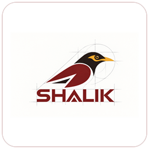
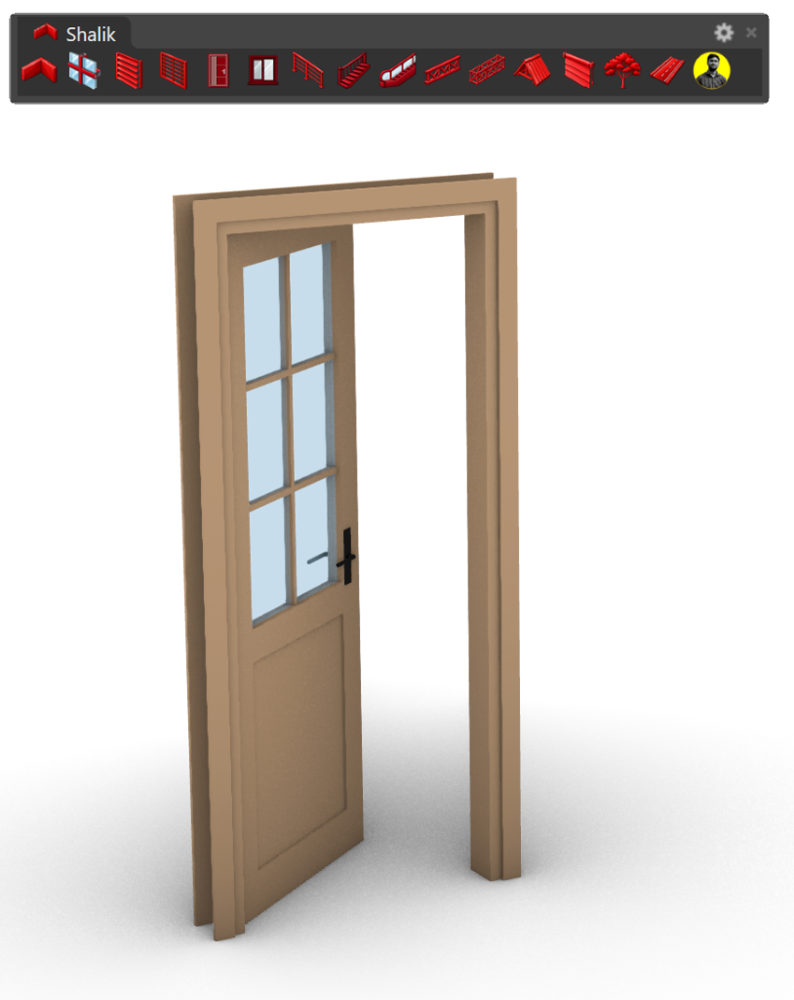
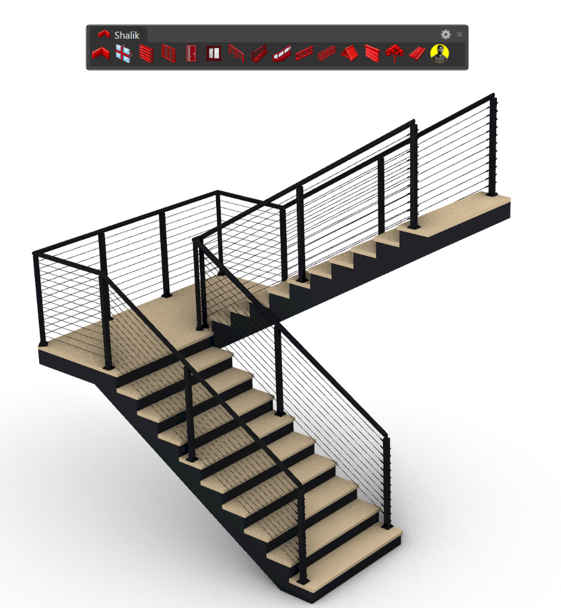
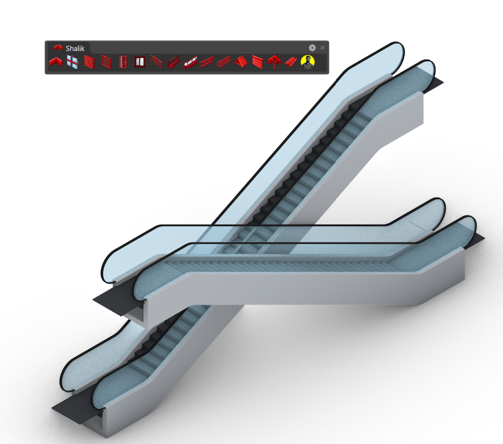

# Shalik for Rhino 8 — Parametric Architectural Modeling Suite & BIM Generator

### **Created & Developed by Sakhawat Hosen Sumon**
**Architect & Computational Software Developer — Dhaka, Bangladesh**

[🌐 Facebook Profile](https://www.facebook.com/sakhawat.sumon2) • [📺 YouTube Channel](https://www.youtube.com/@archsakhawat) • [📧 Email: arch.sakhawat@gmail.com](mailto:arch.sakhawat@gmail.com) • [💬 WhatsApp: +8801521776439](https://wa.me/8801521776439)

**All licenses, copyrights, and intellectual property held exclusively by Sakhawat Hosen Sumon.**

 

---

## **SHALIK ARCHITECTURAL MODELING SUITE**
### High-Performance Parametric Generation Engine for Rhinoceros 8

 

### 📥 **[Download Official Installer: Shalik-1.0.4-Setup.exe](https://github.com/arch-sakhawat/SHALIK-For-Rhino/raw/main/Shalik-1.0.4-Setup.exe)**
**Version:** `1.0.4` • **Update Date:** `October 24, 2026` • **File Size:** `38.1 MB` • **OS:** Windows 10 / 11 64-bit (Rhino 8.0+)

 

👉 **[Alternative Direct Mirror Link](https://raw.githubusercontent.com/arch-sakhawat/SHALIK-For-Rhino/main/Shalik-1.0.4-Setup.exe)**  
🌐 **[Visit Official Web Page](https://arch-sakhawat.github.io/SHALIK-For-Rhino/)**

---

## 📑 Table of Contents
- [Suite Overview](#-suite-overview)
- [Why Shalik vs Grasshopper & Manual Modeling](#-why-shalik-vs-grasshopper--manual-modeling)
- [Included Architectural Tools](#-included-architectural-tools)
- [Pricing & License Plans](#-pricing--license-plans)
- [bKash Payment Method](#-payment-method-bkash)
- [System Requirements](#-system-requirements)
- [Installation Guide](#-installation-guide)
- [Activation Guide](#-activation-guide)
- [Frequently Asked Questions (FAQ)](#-frequently-asked-questions-faq)
- [Support & Inquiries](#-support--inquiries)

---

## 🏛️ Suite Overview

**Shalik for Rhino 8** is an advanced parametric architectural suite and BIM generation engine designed specifically for **McNeel Rhinoceros 8** (Windows x64). Developed by **Architect Sakhawat Hosen Sumon**, Shalik eliminates hours of repetitive 3D modeling by generating complex, code-compliant architectural building elements in seconds with real-time viewport DisplayConduit previews, dynamic unit scaling (Imperial and Metric), and double-click interactive editing.

### ✨ Core Capabilities:
- **Interactive Viewport Display**: Real-time 3D wireframe and shaded preview in Rhino viewports while adjusting parameters before baking geometry.
- **Double-Click to Edit**: Double-click any previously generated door, window, stair, or railing in your Rhino viewport to reopen its parameter dialog and modify it in place.
- **Automatic Wall Openings**: `ArchDoorInWall` and `ArchWindowInWall` automatically cut precise openings through Rhino polysurface walls and insert parametric assemblies.
- **Parametric Presets**: Save and load custom architectural styles as JSON presets.
- **Organized Layering**: Automatically bakes elements onto standardized, color-coded sub-layers (`FRAME`, `PANEL`, `GLASS`, `HARDWARE`, `WALL_CORE`).
- **Dynamic Unit Scaling**: Built-in awareness for Imperial (Inches, Feet) and Metric (Millimeters, Centimeters, Meters) document settings.

---

## 📸 Live 3D Output Showcase

High-fidelity parametric geometry rendered directly in Rhinoceros 8 with the interactive Shalik toolbar:

  
  
  
  
<i>Left: 6-Lite Glazed Contemporary Door | Middle: Quarter-Turn Staircase with Cable Railing | Right: Commercial Crisscross Escalator Suite</i>

---

## ⚡ Why Shalik vs Grasshopper & Manual Modeling

| Feature | Manual Rhino 3D Modeling | Grasshopper Scripts | **Shalik Suite for Rhino 8** |
| :--- | :---: | :---: | :---: |
| **Creation Speed** | Hours per element | Minutes (complex setup) | **Instant (Seconds)** |
| **Live Viewport Preview** | ❌ None | ⚠️ Wireframe only | **✅ Full 3D Interactive Conduits** |
| **Double-Click to Edit** | ❌ Must rebuild | ❌ Must locate GH file | **✅ Native Viewport Double-Click** |
| **Auto Wall Opening Cuts**| ❌ Manual Booleans | ⚠️ Prone to Boolean fails | **✅ 1-Click Parametric Wall Cuts** |
| **Building Code Compliance**| ❌ Manual calculations | ⚠️ Manual formula setup | **✅ Built-in IBC / EN Standards** |
| **Ease of Use** | High effort | Steep learning curve | **✅ Intuitive WinForms Dialogs** |

---

## 🛠️ Included Architectural Tools

| Tool | Rhino Command | Description |
| :--- | :--- | :--- |
| **Door Generator** | `ArchDoor` / `ShalikDoor` | Modern single, double, unequal leaves, pivot, sliding, frame profiles, hardware, and glass inserts. |
| **Window Generator** | `ArchWindow` / `ShalikWindow` | Fixed, casement, sliding, awning, bifold, multi-pane grids, sills, and transom configurations with auto wall cuts. |
| **Staircase Generator** | `ArchStair` / `ShalikStair` | 10 stair systems: Sawtooth, Closed Housed, Central Mono-Stringer, Cantilevered Floating, Spiral, and Dogleg. |
| **Railing Generator** | `ArchRailing` / `ShalikRailing` | 10 railing types: Frameless glass shoe, glass standoff pins, post & clamp, cable rail, and balusters. |
| **Wall Generator** | `ArchWall` / `ShalikWall` | Parametric multi-layer walls with interactive polyline layout, mitered corners, and layer detailing. |
| **Escalator Generator** | `ArchEscalator` / `ShalikEscalator` | Commercial escalators and moving walkways with live 3D truss, step treads, and balustrades. |
| **Curtain Wall Facade** | `ArchCurtainWall` / `ShalikCurtainWall` | Modern facade grid generator with mullions, transoms, spandrels, and baseline alignment. |
| **Truss Generator** | `ArchTruss` / `ArchTruss2D` | Structural Pratt, Warren, Howe, and X-braced trusses in solid 3D or 2D planar centerline drafting. |
| **Space Truss Generator** | `ArchSpaceTruss` / `ShalikSpaceTruss` | Surface-driven 3D structural space frames with pyramid grids and MERO spherical nodes. |
| **Tree & Forest Array** | `ArchTree` / `ArrayTree` | Parametric 3D architectural vegetation (Softwood, Hardwood) and linear/radial forest scattering. |
| **Louver & Sunshade** | `ArchLouver` / `ShalikLouver` | Architectural brise-soleil, aerodynamic fins, vertical and horizontal sunshades. |
| **Pitch Roof Generator** | `ArchPitchRoof` / `PitchRoof` | Hip, gable, shed, and gambrel roofs with 6 tile/cladding types and timber/steel framing systems. |
| **Security & Privacy Grill** | `ArchGrill` / `ShalikGrill` | Architectural window grills and geometric screens with 12 distinct patterns and bar profiles. |
| **Window Blinds & Shades** | `ArchBlind` / `ShalikBlind` | Venetian, Vertical, Roller, and Matchstick window shades with customizable slat rotation angles. |
| **Road & Utility Pole** | `ArchRoad` / `ArchElectricPole` | Urban road corridors, asphalt curbs, sidewalks, crosswalks, street lights, and power poles. |
| **License & Suite Info** | `ArchAbout` / `ArchActivate` | Credits dialog, suite version diagnostics, and license activation management. |

---

## 💳 Pricing & License Plans

### 🎓 Student Special Offer
> [!IMPORTANT]
> ### 🎓 MANDATORY: Proof of Student Status Required
> **Student Discount Eligibility**: This special subsidized rate is strictly reserved for currently enrolled **Architecture, Engineering, Planning, and Design Students**.
> 
> **Proof of student status MUST be provided** when requesting your key:
> - Clear photo of your **valid institutional Student ID Card** (showing valid academic year/date), OR
> - Official university semester registration receipt / student enrollment certificate.
> 
> *Applications submitted without verifiable student proof will NOT be eligible for student pricing and will be charged standard commercial rates.*

| Student Plan | Validity | Price (BDT) | Scope & Features |
| :---: | :---: | :---: | :--- |
| **1 Month** | **30 Days** | **500 ৳** | Complete access to all 15 architectural generators + updates |
| **6 Months** | **180 Days** | **800 ৳** | Complete access to all 15 architectural generators + updates |
| **12 Months (1 Year)** | **365 Days** | **1,500 ৳** | Best value: Full suite access, prioritized support & all updates |

### 🏢 Commercial & Professional Licenses
- Commercial practitioners, architectural studios, visualization firms, and corporate entities will be charged **regular commercial prices**.
- To obtain a commercial quotation or enterprise volume licensing, please contact directly via [**WhatsApp (+8801521776439)**](https://wa.me/8801521776439) or [**Email (arch.sakhawat@gmail.com)**](mailto:arch.sakhawat@gmail.com).

---

## 📱 Payment Method (bKash)

Follow these simple steps to purchase and activate your license:

### Step 1: Send Money via bKash
- **bKash Personal Number:** `01750955823`
- Send the exact amount for your chosen plan (**500 Taka**, **800 Taka**, or **1500 Taka** for students; or agreed commercial fee).

### Step 2: Send Verification Documents (Mandatory)
After sending the money, send the following items via WhatsApp or Email:
1. 📸 **Payment Proof**: bKash payment screenshot or TrxID.
2. 💻 **Machine ID**: Copied from Rhino 8 (`SHLK-XXXX-XXXX-XXXX-XXXX`).
3. 🎓 **Proof of Student Status (Mandatory)**: Clear photo of your valid Student ID card.

- 💬 **WhatsApp:** [**+8801521776439**](https://wa.me/8801521776439) (`01521776439`)
- 📧 **Email:** [**arch.sakhawat@gmail.com**](mailto:arch.sakhawat@gmail.com)

> 💡 **Where to find your Machine ID:**  
> Open Rhino 8, click any Shalik tool (or type `ArchActivate`), and click the **Copy Machine ID** button.

### Step 3: Receive Activation Key
- You will receive your genuine **Activation Key within 24 hours** via WhatsApp or Email.
- Paste the key into the Shalik Activation window and click **Activate License**.
- The status turns green immediately (**ACTIVE**), unlocking all tools!

---

## 💻 System Requirements

- **Operating System**: Windows 10 or Windows 11 (64-bit).
- **Host Application**: **McNeel Rhinoceros 8** (version 8.0 or newer).
- **Hardware**: Standard 64-bit Intel/AMD CPU, 8 GB+ RAM, OpenGL 4.1-capable GPU.

---

## 🚀 Installation Guide

### Step 1: Download
Download the latest installer directly using either link below:
- 📥 **[Download Shalik-1.0.4-Setup.exe (Direct GitHub Raw)](https://github.com/arch-sakhawat/SHALIK-For-Rhino/raw/main/Shalik-1.0.4-Setup.exe)**
- 📥 **[Alternative Mirror Link (raw.githubusercontent.com)](https://raw.githubusercontent.com/arch-sakhawat/SHALIK-For-Rhino/main/Shalik-1.0.4-Setup.exe)**

### Step 2: Install
1. Make sure **Rhino 8 is closed**.
2. Double-click `Shalik-1.0.4-Setup.exe`.
3. Follow the installation wizard. The installer automatically deploys the plug-in (`Shalik.rhp`), toolbar (`Shalik.rui`), and aliases.
4. Click **Finish**.

### Step 3: Launch Rhino 8
1. Open Rhino 8.
2. The **Shalik** ribbon tab and toolbar will load automatically at the top of your workspace.

---

## ❓ Frequently Asked Questions (FAQ)

### What is Shalik for Rhino 8?
Shalik is a professional parametric architectural modeling plug-in for McNeel Rhinoceros 8 (Windows x64). It allows architects and 3D visualizers to quickly create IBC/EN compliant doors, windows, stairs, railings, walls, roofs, and trusses without writing Grasshopper scripts.

### Can I modify parametric objects after creating them?
Yes! Shalik includes a **Double-Click Edit Dispatcher**. Simply double-click any previously generated door, window, stair, or railing in your Rhino viewport to reopen its dialog and adjust parameters on the fly.

### How does automatic wall opening cutting work?
Using `ArchDoorInWall` or `ArchWindowInWall`, click on any Rhino solid wall polysurface. The tool automatically performs solid Boolean difference cuts and inserts the parametric door or window assembly at the exact location.

### Does Shalik support both Imperial (Inches) and Metric (Millimeters)?
Yes! Shalik features document unit intelligence and dynamically scales all parametric parameters, clearance thresholds, and profiles according to whether your Rhino document is set to Inches, Feet, Millimeters, Centimeters, or Meters.

### Do I own the 3D models I create with Shalik?
Yes! All 3D geometric models, drawings, BIM assemblies, and renderings created with Shalik belong **100% to you**. You can freely use them in commercial architectural projects, client deliverables, and construction documents with zero royalty fees.

---

## 📞 Support & Inquiries

For sales, technical support, corporate training, or feature requests:
- **Architect & Author**: Sakhawat Hosen Sumon
- **bKash (Personal)**: `01750955823`
- **WhatsApp**: [**+8801521776439**](https://wa.me/8801521776439) (`01521776439`)
- **Email**: [arch.sakhawat@gmail.com](mailto:arch.sakhawat@gmail.com)
- **Facebook**: [https://www.facebook.com/sakhawat.sumon2](https://www.facebook.com/sakhawat.sumon2)
- **YouTube Tutorials**: [https://www.youtube.com/@archsakhawat](https://www.youtube.com/@archsakhawat)
- **Location**: Dhaka, Bangladesh

---

### Copyright Notice
© 2026 Sakhawat Hosen Sumon. All Rights Reserved Worldwide.  
Rhino® is a registered trademark of Robert McNeel & Associates.
